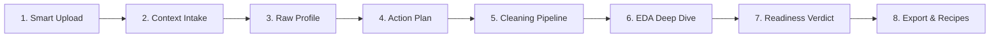

# Automated Data Quality & Analytics Platform (DataLens AI)

DataLens AI is a transparent, explainable, and rule-based data operations platform that transforms raw, messy tabular datasets into analytics-ready assets through an end-to-end, goal-aware workflow.

Zero fabricated numbers. Every metric, correlation, outlier boundary, and insight is strictly computed in memory from your real DataFrame.

---

## End-to-End Goal-Aware Workflow



1. **Smart Upload**: Auto-detects character encoding, CSV delimiters, Excel sheet selection, and header row offset. Generates an instant plain-language file summary card.
2. **Context Intake**: Gathers analytical intent (Machine Learning, Reporting, Business Analysis, Research), target variable, and consumer audience. Runs rule-based domain detection from column names (Finance, Healthcare, E-Commerce, Marketing, HR, SaaS) with user confirmation.
3. **Raw Profile & Quality Scoring**: Inspects structural nulls, data types, uniqueness, validity, and consistency to establish baseline quality health.
4. **Goal-Aware Action Plan (`core/planner/`)**: Maps detected issues + user context into an ordered cleaning roadmap with *What*, *Why*, *Severity*, *Risk Label* (`safe`, `review`, `risky`), and exact *Quality-Score Impact* computed by executing each transformation on an in-memory copy.
5. **8-Stage Cleaning Pipeline (`core/cleaning/`)**:
   - Order: `Structure` ➜ `Types` ➜ `Text` ➜ `Invalid/Placeholders` ➜ `Duplicates` ➜ `Missing Values` ➜ `Outliers` ➜ `Validation`
   - **Auto-clean**: One-click execution of all safe operations without manual intervention.
   - **Approval Gates**: Risky steps (imputations, column pruning, outlier clipping/dropping) strictly require user consent.
   - **Versioned Undo Stack**: Reversible in-memory snapshots; original uploaded data is never mutated.
   - **Audit Log**: Live tracking of step index, operation, stage, rows affected, parameters, and timestamps.
6. **Exploratory Data Analysis (`core/eda/`)**:
   - Univariate statistics (distributions, cardinality, percentiles, skewness, kurtosis).
   - Missing-value co-occurrence matrices and row distributions.
   - Outlier fencing (IQR fences & Z-scores).
   - Bivariate correlations (Pearson linear & Spearman monotonic rank) and group comparisons with a mandatory minimum of 5 observations per group ($n \ge 5$) plus ANOVA F-tests.
   - Target variable analysis (regression correlations or classification class imbalance ratio).
   - Time trends across detected datetime dimensions.
   - **Top 5 Plain-Language Insights**: Dynamically generated using real numbers.
7. **Goal Readiness Verdict (`core/verdict/`)**:
   - Deterministic pass/warn/fail checklist tailored to your declared goal (e.g. data leakage & class balance for ML; deduplication and date consistency for Reporting).
   - Decision support disclaimer noting scores are decision aids rather than mathematical proof.
8. **Export & Recipes (`core/export/` & `core/recipes/`)**:
   - **Before vs. After Comparison**: Rows, columns, missingness %, duplicates, and quality score diffs.
   - **Cleaned Data Downloads**: CSV, Excel (.xlsx), JSON.
   - **Reports & Audit Log**: Comprehensive PDF report, multi-sheet Excel workbook, cleaning log (CSV/JSON).
   - **Reproducible Python Script**: Auto-generated standalone Python/pandas script replicating all applied operations.
   - **Cleaning Recipes**: Export and import `.json` recipe pipelines to automate future files sharing identical schemas.

---

## Messy Sample Datasets (`data/`)

Pre-packaged dirty datasets available for testing and demos:
* `data/sample_ecommerce_dirty.csv`: E-commerce orders with currency strings (`$1,250.00`), negative refunds, duplicate orders, and sentinel placeholders (`N/A`, `-`).
* `data/sample_churn_ml.csv`: Customer churn dataset with leaky ID features, sentinel ages (`999`), and 4:1 class imbalance.
* `data/sample_financial_reporting.xlsx`: Multi-sheet workbook with unformatted revenues, blank headers, and unparsed dates.
* `data/sample_patient_research.csv`: Clinical cohort with extreme physiological outliers (`age=140`), mixed diagnosis casing, and missing outcomes.
* `data/sample_marketing_leads.json`: Marketing campaigns with string casing variants (`FB`, `Facebook`, `facebook `) and conversion rates.

---

## Local Setup

```bash
# 1. Clone & create virtual environment
python -m venv .venv
source .venv/bin/activate  # Windows: .venv\Scripts\activate

# 2. Install dependencies
pip install -r requirements-dev.txt

# 3. Run application
streamlit run app.py

# 4. Run automated test suite
pytest -v
```

---

## Architecture Principles

* **Logic in `core/`**: Pure functions, small typed APIs, dataclasses, zero Streamlit dependencies in analytical engines.
* **Thin UI in `ui/pages/`**: Streamlit pages focused purely on rendering components, charts, and handling user triggers.
* **Centralized State in `core/utils/state.py`**: Immutable `original_df`, mutable `working_df`, versioned snapshot stack for undo, and audit logs stored in session state.
* **No Fabricated Numbers**: All metrics derived directly from real DataFrame computations.

---

## License

This project is licensed under the [MIT License](LICENSE).
